<!-- Improved compatibility of back to top link: See: https://github.com/othneildrew/Best-README-Template/pull/73 -->
<a id="readme-top"></a>

<!-- PROJECT LOGO -->
<br />
<div align="center">
  <a href="https://github.com/carelesswhisp/BetterBirb-Plus">
     
  </a>

<h3 align="center">Better Birb ++</h3>

  <p align="center">
    A better birb then you in everyway. Better in every other way!
    <br />
  </p>
</div>


<!-- TABLE OF CONTENTS -->
<details>
  <summary>Table of Contents</summary>
  <ol>
    <li>
      <a href="#about-the-project">About The Project</a>
      <ul>
        <li><a href="#built-with">Built With</a></li>
      </ul>
    </li>
    <li>
      <a href="#getting-started">Getting Started</a>
      <ul>
        <li><a href="#prerequisites">Prerequisites</a></li>
        <li><a href="#installation">Installation</a></li>
      </ul>
    </li>
    <li><a href="#usage">Usage</a></li>
    <li><a href="#roadmap">Roadmap</a></li>
    <li><a href="#contributing">Contributing</a></li>
    <li><a href="#license">License</a></li>
    <li><a href="#contact">Contact</a></li>
    <li><a href="#acknowledgments">Acknowledgments</a></li>
  </ol>
</details>


<!-- ABOUT THE PROJECT -->
## About The Project


Better Birb is a modification of posty-birb+. It mainly adds features that I wanted for my own use cases. the code is far from efficient in a lot of ways and can be greatly approved upon. like with most of my projects, this was done for me first and foremost. then offered to you loevely people to share the love. this was developped on and off for a year and change, so there's some mixing and matching with the code you'll see through out. but it runs and performs all actions as intended. 


<!-- GETTING STARTED -->
## Getting Started
This project relies on a few others besides posty birb. mainly

https://github.com/deepseek-ai/DeepSeek-VL2  
for ttile generation

https://huggingface.co/SmilingWolf/wd-eva02-large-tagger-v3  
for auto tagging

### Prerequisites

inside resources\AiTagger folder
you will want to make a ven for the installing of the specific python version and other preqs so you don't conflict with anything else you're making.  
use python version 3.10.6  
install requiremnts.txt

  ```sh
    pip install -r requirements.txt
  ```

### Installation
If using the release then simply double click the EXE for installing and you're off to the races.  
If you want to build this from source, i find that you need to run the following operations 

1. set node options
   ```sh
   set NODE_OPTIONS=--openssl-legacy-provider
   ```
2. build the app
   ```sh
   npm run build
   ```
3. to start it, you need to unset node options
   ```sh
   set NODE_OPTIONS=
   ```
4. and start with
   ```sh
   npm start
   ```
There are different ways AiTagger is called based on being built for distribution vs debugging. 
in electron-app\src\main.ts you will comment and uncomment the paths based on what your current build is. 
<p align="right">(<a href="#readme-top">back to top</a>)</p>


<!-- Main Changes -->
## Main Changes

cascade:  
This makes it so if you have a new image that needs to be scheduled for an event, but you've already laid out your schedule for the month, ie one image every three days. you can turn on this feature then schedule the image, and set how many days after the image would be published to push all the future scheduled submissions. so if you want to essentially take the slot of that other image, you can push everything else back by 3 days, and maintain your posting schedule 
to use this click the tick box, yes it’s in a horrible spot but function over form atm,

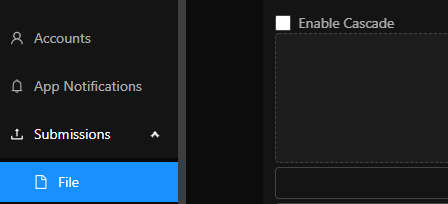

you can choose to apply the cascade to only one site, like you only want to move the posts up for patreon and ignore all others or apply the cascade for every site. 

 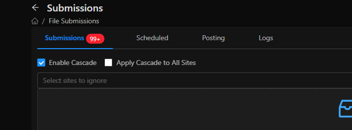

(this would be better suited for sites to include, but this was done so I could not effect patreon posts but effect all other) 

a list of all effected submissions will appear with their original date of being posted and the new one  
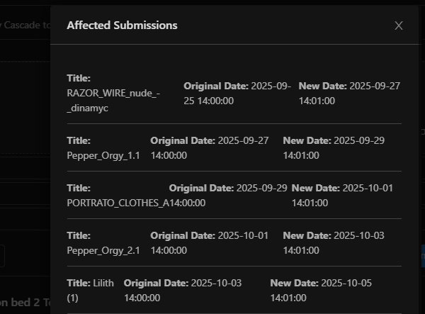
 
then hit schedule many to see the new options including time between posts. So between this new post and the next one

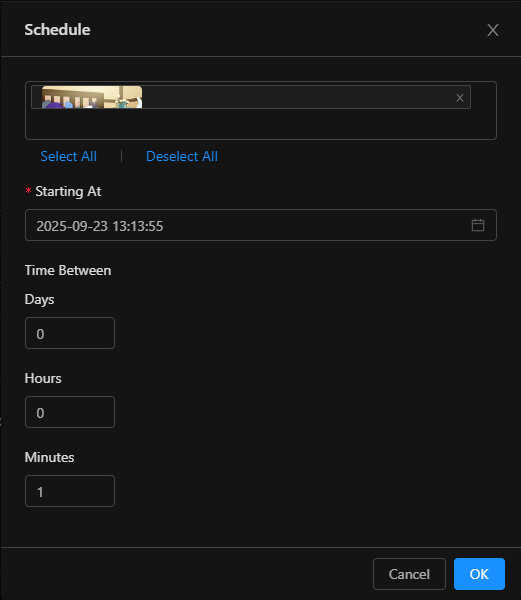

Auto tag: auto-tag will as the name suggests use an auto tagger to tag the items for various sites for you. this works off of waifu diffusion, wd-eva02-large-tagger-v3 using smilingwolf's tagging engine https://huggingface.co/SmilingWolf/wd-eva02-large-tagger-v3

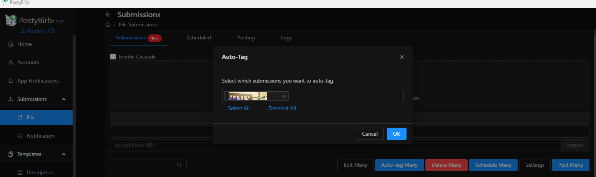
 

Tag sanitization: not sure how to name this, but one issue with cross posting is some tags just don't exist in other places 1girl works for gelbooru, but not for Derpibooru. so this function will now show you tags that were removed for what sites due to not meeting the minimum threshold. You can choose to add it though regardless. 

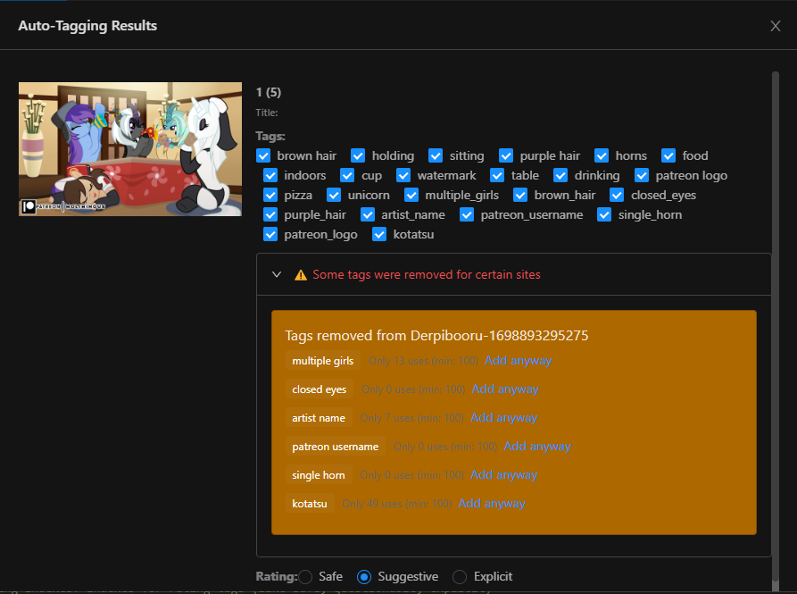

Automatic Image Ratings: various sites like derpi and DeviantArt both have image ratings, honestly most sites do. If you’re like me you have a ton of images sometimes to upload. This will automatically decide based on the tags if the rating is safe, suggestive or explicit. We have these mapped to all the main sites posty uses. Not always 100% accurate so you can quickly scroll down and choose yourself too.

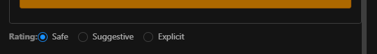

Title Generation: This was the biggest issue, this will generate a title for all the current images being edited, with an option to regenerate the images title individually. This right now is set up for deepseek-vl2 with a jail break conversation that seems to always work, that allows the generation of adult themed titles. Right now it’s a two part system that’s not automatically fired on the server end. Because vl2 is heavy I made this remote unlike auto tagger. You will run the python script TBN (currently multigpu.py) on your server.

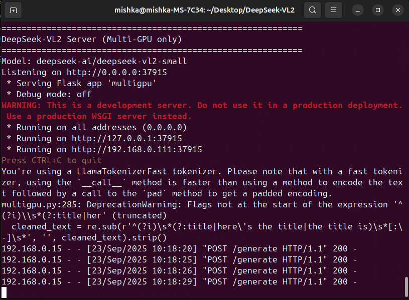

(this could be your local pc) then you would edit the Ip address in the settings to connect to this remote server. 
Making this work with multigpu was a very difficult and annoying experience that I hope I can save you the headache of. Pretty much solved by mirroring what as done by this user https://github.com/weedge for their achatbot

generation results will be like so 

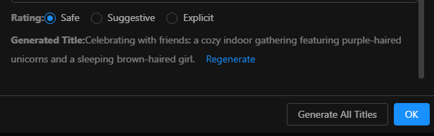

it's not always the best, and that’s why the regeneration option is there. But if you’re compiling yourself you can also just adjust the text used to tell it how to generate in the source python file 

tagger.py

Image Thumbnail Size increase: I’m a size queen and wanted these to be bigger 

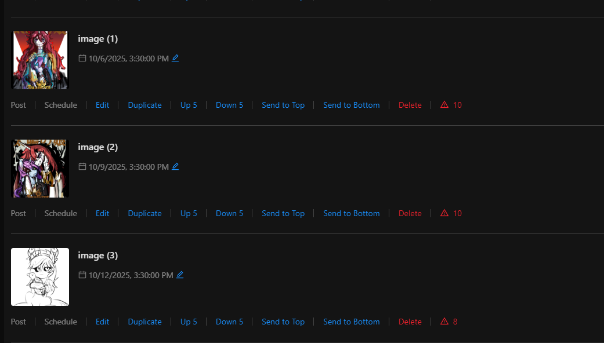

Random Messages: when posting it gets boring to just have it say follow my blank blank. So I added random messages in the templates section 

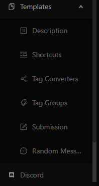

Each line is a random message it will pull and use in the description. Mainly used with twitter since having a link in the first post will devalue it in the algorithm. So a snappy little comment is nice. 
 
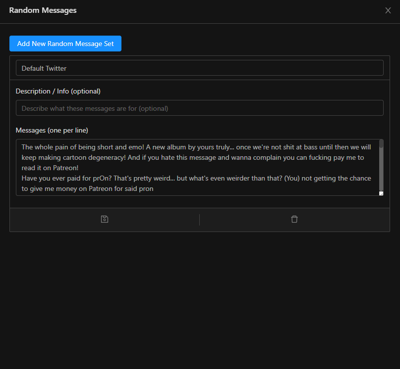

This can be turned on in the edit file submission with a toggle, and you can add a reply message. 

this is for your normal shilling link back to your patreon or wherever. It replies to the post you made automatically 
 
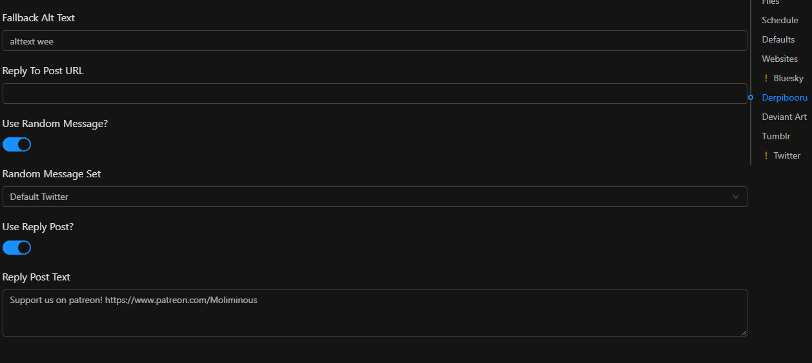

ultimately it will look like this 

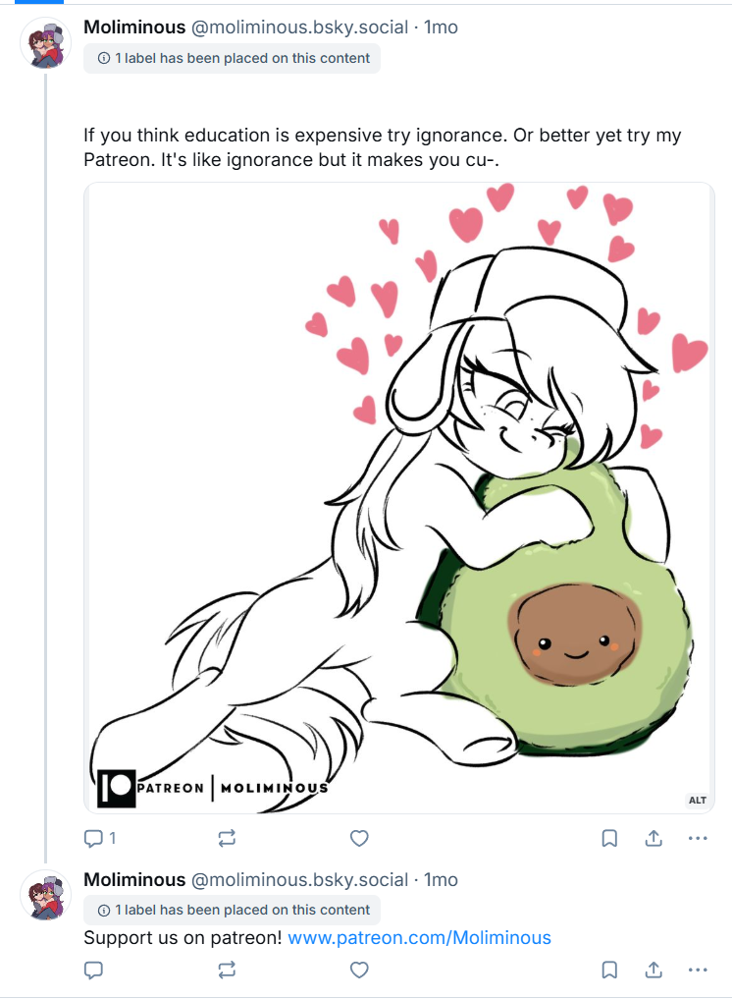

<p align="right">(<a href="#readme-top">back to top</a>)</p>


### Top contributors:

<a href="https://github.com/carelesswhisp/BetterBirb-Plus/graphs/contributors">
  
</a>


<!-- LICENSE -->
## License

Distributed under the project_license. See `LICENSE.txt` for more information.

<p align="right">(<a href="#readme-top">back to top</a>)</p>


<!-- MARKDOWN LINKS & IMAGES -->
<!-- https://www.markdownguide.org/basic-syntax/#reference-style-links -->
[contributors-shield]: https://img.shields.io/github/contributors/github_username/repo_name.svg?style=for-the-badge
[contributors-url]: https://github.com/carelesswhisp/BetterBirb-Plus/graphs/contributors
[forks-shield]: https://img.shields.io/github/forks/github_username/repo_name.svg?style=for-the-badge
[forks-url]: https://github.com/github_username/repo_name/network/members
[stars-shield]: https://img.shields.io/github/stars/github_username/repo_name.svg?style=for-the-badge
[stars-url]: https://github.com/github_username/repo_name/stargazers
[issues-shield]: https://img.shields.io/github/issues/github_username/repo_name.svg?style=for-the-badge
[issues-url]: https://github.com/github_username/repo_name/issues
[license-shield]: https://img.shields.io/github/license/github_username/repo_name.svg?style=for-the-badge
[license-url]: https://github.com/github_username/repo_name/blob/master/LICENSE.txt
[linkedin-shield]: https://img.shields.io/badge/-LinkedIn-black.svg?style=for-the-badge&logo=linkedin&colorB=555
[linkedin-url]: https://linkedin.com/in/linkedin_username
[product-screenshot]: images/screenshot.png
<!-- Shields.io badges. You can a comprehensive list with many more badges at: https://github.com/inttter/md-badges -->
[Next.js]: https://img.shields.io/badge/next.js-000000?style=for-the-badge&logo=nextdotjs&logoColor=white
[Next-url]: https://nextjs.org/
[React.js]: https://img.shields.io/badge/React-20232A?style=for-the-badge&logo=react&logoColor=61DAFB
[React-url]: https://reactjs.org/
[Vue.js]: https://img.shields.io/badge/Vue.js-35495E?style=for-the-badge&logo=vuedotjs&logoColor=4FC08D
[Vue-url]: https://vuejs.org/
[Angular.io]: https://img.shields.io/badge/Angular-DD0031?style=for-the-badge&logo=angular&logoColor=white
[Angular-url]: https://angular.io/
[Svelte.dev]: https://img.shields.io/badge/Svelte-4A4A55?style=for-the-badge&logo=svelte&logoColor=FF3E00
[Svelte-url]: https://svelte.dev/
[Laravel.com]: https://img.shields.io/badge/Laravel-FF2D20?style=for-the-badge&logo=laravel&logoColor=white
[Laravel-url]: https://laravel.com
[Bootstrap.com]: https://img.shields.io/badge/Bootstrap-563D7C?style=for-the-badge&logo=bootstrap&logoColor=white
[Bootstrap-url]: https://getbootstrap.com
[JQuery.com]: https://img.shields.io/badge/jQuery-0769AD?style=for-the-badge&logo=jquery&logoColor=white
[JQuery-url]: https://jquery.com 
